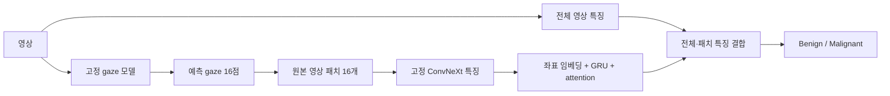

# Gaze 기반 benign/malignant 분류

`trajectory_1011`의 최적 checkpoint(`runs/full_1011_seed42/improved/best.pt`, epoch12)를 고정하고 영상 단위 이진 분류 head를 추가했다. 입력 영상에서 gaze16점을 자유 생성하고 원본 해상도의224×224 패치를 추출한다. 전체 영상 특징과 패치 특징 모두 같은 gaze ConvNeXt encoder로 계산한다.



세 분류 모델을 같은 데이터·seed·optimizer 설정으로 비교한다.

| 모델 | 입력 | 학습 대상 |
|---|---|---|
| global | 전체 영상 특징 | global projection 및 분류 head |
| gaze | 전체 영상 + 예측 gaze 패치 특징/좌표 | global/local projection, GRU, attention, fusion head |
| grid | 전체 영상 + image-only foreground grid16 패치 특징/좌표 | gaze와 같은 분류 구조 |

gaze 생성은 argmax 반복 수렴을 고려하여 sampling seed42, policy none을 사용한다. 이미지 ID별 seed를 고정하며 학습과 추론 모두 CPU RNG에서 sampling한다. GT gaze, 병변 박스, 진단 라벨은 경로 생성·패치 선택의 입력이 아니다. 분류 라벨은 BCE loss와 평가에만 사용한다. attention은 분류기 내부의 가중치이며 병변 위치 정답이 아니다.

## 데이터와 평가 범위

- train376장/306환자: benign187, malignant189.
- validation93장/77환자: benign46, malignant47.
- COCO 유래 영상 라벨에서 benign=0, malignant 또는 혼합=1. unknown=-1은 제외한다.
- 기존 환자 단위 split을 유지하고 gaze initializer의 train/selection 환자 범위를 검사한다.
- gaze 모델은 같은 train 환자로 사전학습됐다. 이는 frozen-feature transfer이며 OOF/cross-fitting 실험은 아니다.
- validation은 gaze 모델 선택과 분류 모델 선택에 재사용됐으므로 탐색적 validation 성능이다. 독립 test 성능으로 보고하지 않는다. 최종 test와 INbreast는 사용하지 않는다.
- 분류 AUROC로 best epoch를 선택한다. 최대60epochs, patience12, AdamW lr3e-4/weight decay0.01, batch32, dim128, dropout0.3, seed42.
- AUROC/AUPRC와 고정 threshold0.5의 민감도·특이도·혼동행렬을 보고한다. 출력 sigmoid 확률은 별도 calibration하지 않았다.
- AUROC 및 모델 차이는 동일 환자 단위 bootstrap1000회로 평가한다. CI는 checkpoint 선택 편향이나 training seed 불확실성을 제거하지 않는다.

## 실행

상위 `/home/njsung/NJ_BK/code`에서 실행한다. 기존 산출물 덮어쓰기를 막으므로 재실행에는 새 output 경로를 사용한다.

```bash
python gaze_mammo/scripts/classify_gaze_1011.py train \
  --gaze-checkpoint gaze_mammo/runs/full_1011_seed42/improved \
  --output gaze_mammo/runs/classification_1011_seed42 --device cuda:0
```

학습은 특징을 한 번 추출한 뒤 고정 특징으로 세 head를 훈련한다. encoder/gaze 가중치를 분류 loss로 미세조정하지 않는 첫 단계 구현이다. 분류 checkpoint는 head 가중치만 저장하여 각 약0.5–1.4MiB이고, 추론 시 동일한 gaze checkpoint를 함께 사용한다. SHA256이 맞지 않으면 추론을 거부한다.

```bash
python gaze_mammo/scripts/classify_gaze_1011.py predict \
  --gaze-checkpoint gaze_mammo/runs/full_1011_seed42/improved \
  --classifier gaze_mammo/runs/classification_1011_seed42/gaze \
  --image gaze_mammo/data/image/Mass-Training_P_00026_LEFT_CC_BENIGN.png \
  --image-id 64 --device cuda:0 \
  --output gaze_mammo/runs/classification_1011_seed42/case64
```

새 영상 추론은 image와 checkpoint만 읽고 manifest/GT gaze/라벨/박스를 읽지 않는다. 영상은 기존 데이터와 같은1500×3000 전처리를 요구한다. `--image-id`는 RNG를 고정하는 정수이며 정답 정보를 전달하지 않는다. `prediction.json`에 malignant/benign 확률, threshold, 예측 gaze, attention과 checkpoint hash를 저장하고 `classification.png`에 시선 경로와 상위 attention 패치를 표시한다.

## 검증과 산출물

신규4개 및 전체52개 unittest 통과. 신규 검증은 global/local/GRU/attention의 gradient, checkpoint 복원, 순서 민감성, global 대조군의 local 입력 독립성, 환자 누수·unknown 제외, GT gaze 접근을 금지한 image-only 특징 추출을 포함한다. 실제 gaze checkpoint로 GPU train4/val4,2epoch smoke도 완료했다. smoke 수치는 성능 근거가 아니며 해당 임시 가중치는 사용자의 용량 정리 요청에 따라 삭제했다.

전체 실행 결과는 `runs/classification_1011_seed42/`에 저장한다. `status.json`, `report.md`, `classification_curves.png`, `comparison.json`, `paired_auroc_difference.json`, 각 모델별 `best.pt`, `validation_predictions.csv`, `validation_metrics.json`을 확인한다. 특징·환자 정보와 gaze provenance는 `features.pt`, `population.csv`, `feature_provenance.json`에 남는다.


## 전체 학습 결과 (2026-10-11)

전체 train376/val93 실행을 완료했다. 특징 추출131.96초를 포함하여151.67초 걸렸다. 사전 지정한 patience12에 따라 global14epochs, gaze/grid15epochs에서 조기 종료했고, best epoch는 각각2/3/3이다.

| 모델 | Validation AUROC | 환자 bootstrap95%CI | AUPRC |
|---|---:|---|---:|
| global | 0.7586 | [0.6472, 0.8592] | 0.7885 |
| gaze | 0.7331 | [0.6138, 0.8345] | 0.7480 |
| grid | 0.7410 | [0.6259, 0.8447] | 0.7550 |

현재 실험에서 gaze 결합의 추가 이점은 확인되지 않았다. gaze−global AUROC 차이는−0.0254, paired95%CI[−0.1001,+0.0453]이며 gaze−grid는−0.0079, CI[−0.0741,+0.0589]다. 유의한 우열이나 독립 test 성능을 주장하지 않는다.

고정 validation case64를 이미지 단독으로 다시 추론했다. P(malignant)=0.467630으로 threshold0.5에서 benign으로 분류했다. 사후 확인한 GT도 benign이다. 평가 CSV와 확률 차이는5.01e-8이며 예측 좌표·attention도 일치했다. 이 케이스의 attention은 약0.061–0.065로 거의 균등하므로 상위3개 패치 표시를 강한 국소 병변 근거로 해석하지 않는다.

- [전체 결과와 ROC/학습 곡선](runs/classification_1011_seed42/report.md)
- [영상 단독 분류·gaze 시각화](runs/classification_1011_seed42/case64/classification.png)
- [영상 단독 예측 JSON](runs/classification_1011_seed42/case64/prediction.json)
- [gaze 분류 head checkpoint](runs/classification_1011_seed42/gaze/best.pt)

후속 후보는 global 정보를 보존하는 residual fusion, 패치 encoder의 제한적 fine-tuning, gaze와 grid를 함께 이용한 coverage 보완이다. 이번 요청에서는 위 frozen-head 비교까지 수행했으며 후속 후보는 아직 학습하지 않았다.
