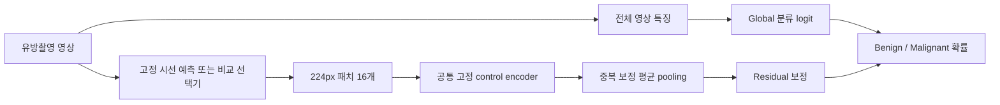

# 시선 기반 패치 분류 개발 결과

2026-10-12. [개발 전에 작성한 계획](plan_gaze_patch_classification_1012.md)에 따라 GPT-6.1-Sol low 서브에이전트가 추출기와 분류 도구를 구현했고, 부모가 검토·실제 동작 검증을 수행했다.

## 본 실험 실행

후속 사용자 요청에 따라 tmux `gaze_patch_classification_1012`에서 본 실험을 시작했다. GPU0에서 labeled train376/validation93 전체의 특징을 추출한 다음, 같은 cache로6개 arm×3개 head seed의18개 분류기를 CPU에서 학습한다. 최대60epoch/patience12와5000회 paired patient bootstrap을 적용한다. TEST/INbreast를 사용하지 않으며 기존 시선 source는 동결한다. 아래 개발 smoke 기록과 본학습 결과를 구분한다.

- [실행 조건과 고정 소스 SHA](runs/gaze_patch_classification_1012_training/run_manifest.json)
- [현재 실행 상태](runs/gaze_patch_classification_1012_training/state.json)
- 추출 로그: `runs/gaze_patch_classification_1012_training/extract_features.log`
- 학습 로그: `runs/gaze_patch_classification_1012_training/train_classifiers.log` (추출 완료 후 생성)
- 완료 결과: `runs/gaze_patch_classification_1012_full/report.json` 및 `report.md`

세션 확인: `tmux attach -t gaze_patch_classification_1012`. 두 단계 중 오류가 발생하면 다음 단계를 실행하지 않고 `state.json`에 실패 원인을 기록한다. 완료한 세션 화면은 유지한다.



Global 단독과 random/grid/proposal/순수 gaze/hybrid의 다섯 패치 방식을 비교한다. Proposal16은 시선 확률을 계산하지 않고 후보 박스를 선택한다. Gaze16은 ROI branch 없이 이전 예측 좌표와 실제 과거 패치에서 다음 좌표를 생성한다. Hybrid는 기존 ROI14+RAW2를 그대로 사용한다. 패치 방식끼리 동일한16개 크롭·분류 encoder·mean residual 구조를 사용하며 global은 패치가 없는 기준점이다.

## 완료한 검증

- 신규11개 및 기존 분류·attention10개, 총21개 검증 통과.
- 실제 GPU 영상8장(train4/val4, 각 split 양성2/악성2)에서 다섯 방식640개 패치 특징을 추출했다. 현재 시선 모델의 재학습 캐시를 삭제한 뒤에도 원본 source가 정상 복원되고 추출됐다.
- 동일 cache로 global+다섯 패치 분류기를 각각2epoch 학습하는 CPU 기능 검증이 완료됐다. source encoder는 동결됐고 patch checkpoint에는 큰 encoder/global 가중치를 복제하지 않았다.
- 별도의 원영상 case64 추론과 cache의 gaze 좌표 차이는0, 분류 확률 차이는1.25e-8이었다. 생성·패치 선택에는 실제 시선/병변 박스/라벨/진단 filename 문자열을 입력하지 않는다.
- TEST와 INbreast는 새 개발에서 사용하지 않았다. Source checkpoint9개 환자 provenance, source/config/image hash, row 라벨 및 실제 crop 기하를 확인했다.

**이는 기능 smoke이며 분류 성능 향상 결과가 아니다.** Validation4장의 AUROC로 patch epoch0가 선택됐고, 해당 선택 모델은 global 기준점과 같은 예측을 한다. 본 실험에서는 개발용8장 대신 기존 labeled train376/val93 전체에서3head-seed 비교가 필요하다. 이미 반복 사용한 validation은 탐색적 결과이며, 기존 TEST도 관측된 cohort라 최종 일반화 주장에는 미사용 환자 평가가 필요하다.

- [부모의 독립 검증](runs/gaze_patch_classifier_1012_smoke/parent_verification.json)
- [동작 검증 보고서](runs/gaze_patch_classifier_1012_smoke/report.md), [전체 JSON](runs/gaze_patch_classifier_1012_smoke/report.json)
- [영상 단독 예측](runs/gaze_patch_classifier_1012_smoke/image_only_case64.json)
- [공통 encoder 및 source 환자 provenance](runs/gaze_patch_classification_1012_smoke8/provenance.json)

## 실행

Repository 루트에서 실행한다. 모든 output은 새로운 경로여야 한다. 다음은 **전체 본 실험을 실행하는 명령**이며 이번 개발에서는 실행하지 않았다.

```bash
python scripts/cache_gaze_patch_features_1012.py \
  --output runs/gaze_patch_classification_1012_full_features --device cuda:0

python scripts/train_gaze_patch_classifier_1012.py \
  --cache runs/gaze_patch_classification_1012_full_features/features.pt \
  --output runs/gaze_patch_classification_1012_full \
  --seeds 42 43 44 --epochs 60 --bootstrap 5000
```

Primary K=16, head seed42/43/44, 경로 seed42다. `--k 4`/`--k 8`은 같은16점 cache의 prefix를 사용하는 보조 실험 옵션이며, 별도 output에서 학습한다. 단일 head의 mean/SD와 확률 ensemble을 따로 보고하고, AUROC/AUPRC/accuracy/balanced accuracy/민감도/특이도/F1/Brier/혼동행렬 및 paired patient bootstrap 차이를 저장한다. Threshold=.5를 고정한다.

영상 단독 추론은 image, 숫자 image ID, source config, 선택 head와 대응하는 global checkpoint만 사용한다. Manifest나 GT payload를 읽지 않는다.

```bash
python scripts/predict_gaze_patch_classifier_1012.py \
  --image data/image/Mass-Training_P_00026_LEFT_CC_BENIGN.png --image-id 64 \
  --checkpoint runs/gaze_patch_classifier_1012_smoke/gaze_seed42/best.pt \
  --global-checkpoint runs/gaze_patch_classifier_1012_smoke/global_seed42/best.pt \
  --source-config runs/dual_target_1011/mammo_clip_unified_runtime/config.json \
  --output runs/new_image_prediction.json --device cuda:0
```

위 명령의 smoke head는 동작 예시용이며 연구 성능 또는 임상 추론용 모델이 아니다. `global` arm은 `--global-checkpoint`가 필요 없다. Attention과 signed contribution은 pooling 설명이며 개별 patch의 악성 확률이 아니다.

Cache는 source/config/encoder/image/manifest/code hash를 검사한다. 관련 코드를 변경하면 새 cache를 생성해야 한다. 영상마다 공통 source memory를 재사용하므로 기록된 arm별 selector time은 독립적인 배포 latency 비교로 사용하지 않는다. 경로 source memory time과 공통 분류 특징 추출 time은 별도 기록된다.

## 코드와 재검증

- [추출기](src/gaze_patch_features_1012.py), [cache CLI](scripts/cache_gaze_patch_features_1012.py)
- [분류 helper](src/gaze_patch_classifier_1012.py), [학습](scripts/train_gaze_patch_classifier_1012.py), [이미지 단독 추론](scripts/predict_gaze_patch_classifier_1012.py)

```bash
python -m unittest tests.test_gaze_patch_features_1012 tests.test_gaze_classifier_1011 tests.test_gaze_attention_1011
PYTHONPATH=. python tests/test_gaze_patch_classifier_1012.py
python scripts/audit_gaze_patch_classification_1012.py
```

[정리 기록](cleanup_classification_scope_20261012.json)과 [정리 검증](cleanup_classification_scope_verification_20261012.json)에 삭제한13,815,921,417bytes,4,286개tensor파일 및 압축 보관한HAT코드22개를 기록했다. 기존 source·분류/attention 결과와 TEST 증거는 보존했다. 삭제한 과거 training cache는 해당 gaze 모델을 재학습할 때 재생성해야 한다.
