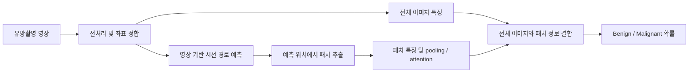

# GazeMammo Preliminary Study — 시선 예측을 활용한 유방촬영 영상 분류

[GitHub 저장소](https://github.com/nakjun/GazeMammo-Preliminary-Study)

유방촬영 영상에서 **시선 경로를 예측하고, 예측 위치의 패치를 추출해 Benign/Malignant 분류에 활용**하는 연구 코드입니다. 전문가의 시선은 학습 감독으로 활용하고, 추론에서는 영상만으로 패치 위치를 결정합니다.

> 연구 진행 상태: 2026-10-14 기준 탐색 실험 단계이며, 반복 학습은 일시중지했습니다. 목표인 classifier seed 42/43/44 평균 VAL AUROC 0.88은 아직 달성하지 못했습니다.

## 연구 가설

**전체 이미지가 제공하는 전반적인 정보에, 예측 시선 패치가 제공하는 국소 병변 정보를 추가하면 양성·악성 분류 성능이 향상될 것이다.**

이 가설을 검증하기 위해 다음 질문을 구분합니다.

1. 시선 모델은 병변과 관련된 위치를 예측하는가?
2. 해당 패치는 전체 이미지 단독 모델에 추가 정보를 제공하는가?
3. 그 효과는 동일 개수의 랜덤 패치보다 큰가?
4. 패치 개수와 주변 문맥 크기를 바꾸면 분류 성능이 어떻게 달라지는가?

병변 확보율이나 시선 예측 NLL의 개선이 분류 AUROC 향상을 보장하지는 않습니다. 최종 목적은 시선 자체의 재현을 넘어, **예측 시선을 통한 분류 성능 개선**을 확인하는 것입니다.

## 전체 흐름



시선 예측은 이전 예측 위치와 해당 위치에서 얻은 시각 정보를 이용하는 방식으로 실험했습니다. 분류에서는 전체 이미지 단독, 전체 이미지 + 시선 패치, 전체 이미지 + 랜덤 패치를 비교합니다. Grid 패치는 별도의 공간 커버리지 기준선입니다.

## 데이터와 평가 원칙

- **시선 데이터:** [GAA-DETR 원본 GitHub](https://github.com/YanKong0408/GAA-DETR)의 breast subset. 다운로드 출처는 [GAA-DETR-breast](https://huggingface.co/datasets/yankon0408/GAA-DETR-breast)입니다.
- **데이터셋 논문:** [Query-Level Alignment for End-to-End Lesion Detection with Human Gaze, MICCAI 2025](https://papers.miccai.org/miccai-2025/0738-Paper1266.html).
- **분류 데이터:** CBIS-DDSM. 현재 환자 분리 개발 코호트는 TRAIN 2,037장 / VAL 356장이며, 환자 수는 각각 1,034명 / 183명입니다.
- 전처리·정합 후 사용할 수 있는 실제 시선 표본은 TRAIN 420장 / VAL 77장입니다. 분류 영상 전체에 실제 시선이 있는 것은 아닙니다.
- 원본 영상과 시선 좌표의 변환을 정합하고, canonical 영상 1,500 × 3,000에서 패치를 추출합니다. 전처리 근거는 [PREPROCESS_ALIGNMENT_V2_1012.md](PREPROCESS_ALIGNMENT_V2_1012.md)에 기록했습니다.
- 최근 실험은 TRAIN 내부의 환자 분리 holdout에서 epoch·설정을 선택한 뒤 전체 TRAIN으로 다시 학습하고 VAL을 평가합니다. TRAIN의 예측 시선 특징은 patient out-of-fold 방식으로 생성합니다.
- 추론 시 실제 시선, 병변 정답 박스, 정답 진단 라벨을 패치 선택 입력으로 사용하지 않습니다. TRAIN 병변 감독을 활용한 별도 실험은 구분해서 기록합니다.
- 최근 목표 실험에서 TEST는 학습이나 설정 선택에 사용하지 않았습니다. 과거 TEST 평가 기록은 보존하지만 최신 모델의 TEST 성능으로 인용하지 않습니다.
- CC/MLO 정보 통합 결과와 단일 영상 결과를 구분합니다. 환자 단위 분석과 영상 단위 지표도 같은 값으로 취급하지 않습니다.

## 지금까지 확인한 결과

### Grid 14개를 고정한 시선 패치 개수 비교

다음은 classifier seed 42/43/44의 **CC/MLO 확률 평균 통합 VAL AUROC 평균**입니다. 각 행은 Grid14에 해당 패치를 추가한 구성입니다.

| 추가 패치 수 | 예측 시선 패치 | 랜덤 패치 |
|---:|---:|---:|
| 0 | 0.83489 | 0.83489 |
| 1 | 0.83463 | 0.83340 |
| 2 | 0.85012 | 0.83315 |
| 4 | **0.85035** | 0.82654 |
| 8 | 0.83646 | 0.83278 |
| 16 | 0.82792 | 0.82201 |

전체 탐색에서 가장 높은 3-seed 평균은 **Grid14 + Gaze4의 0.85035**입니다. Gaze4와 Gaze2의 차이는 작아 Gaze4의 우월성을 확정하지 않습니다. K16은 중복 제거 후 실제 유효 패치 수가 대조군과 달라 해석에 주의해야 합니다. 이 실험은 이후의 fresh OOF 시선 모델·전체 이미지 결합 실험과 선택기 및 입력 구성이 다릅니다.

### 동일 조건 백본 비교

동일 시선 8개와 랜덤 8개, 동결된 ImageNet 사전학습 백본을 이용한 **seed42의 CC/MLO 특징 평균 통합 VAL AUROC**입니다.

| 백본 | 전체 이미지 | + 시선 8개 | + 랜덤 8개 |
|---|---:|---:|---:|
| ConvNeXt-Base | 0.76369 | 0.76070 | 0.78219 |
| DenseNet-121 | 0.71700 | 0.70288 | 0.75966 |
| ResNet-50 | 0.73038 | 0.73114 | 0.72456 |

이 비교에서는 백본 변경으로 성능이 향상되지 않았습니다. 위 Grid14 결과와 결합 방식이 다르므로 두 표의 차이를 백본 효과로 해석할 수 없습니다.

### 전체 이미지 + 시선 패치 결합 개선

공간 정보를 유지한 ConvNeXt 전체 이미지 모델을 고정하고, 작은 attention residual로 패치 정보를 추가한 최근 seed42 결과입니다.

| 구성 | CC/MLO 통합 VAL AUROC |
|---|---:|
| 전체 이미지 단독 | 0.83254 |
| + 예측 시선 8개 | 0.83200 |
| + 동일 개수 랜덤 8개 | 0.83207 |

이 구성에서는 시선 패치의 추가 이득이 확인되지 않았습니다. 병변 위치 확보율을 높여도 분류 성능이 함께 증가하지 않은 실험이 있었으며, 높은 TRAIN 성능과 낮은 VAL 성능의 격차도 관찰했습니다. **위치 예측, 패치의 진단 정보, 결합 모델의 일반화**를 각각 검증할 필요가 있습니다.

모든 표는 탐색적 VAL 결과입니다. 같은 VAL을 여러 실험에서 반복 관측했으므로 미사용 평가 코호트에서의 일반화 성능이나 기존 연구 대비 SOTA를 주장하지 않습니다. 목표의 3-seed 평균과 단일 seed 또는 확률 ensemble 성능도 구분합니다.

## 실험 진행 방향

1. **전처리와 좌표 정합:** 원본 영상 변환과 실제 크롭 좌표를 맞추고 환자 분리·영상 SHA를 검증합니다.
2. **시선 경로 모델링:** 전문가 시선을 학습하고 TRAIN OOF / VAL 영상 단독 경로를 생성합니다. 병변 감독 추가와 중복 억제도 별도 비교합니다.
3. **패치 개수:** Grid14 고정 조건에서 시선 패치 수 1/2/4/8/16을 비교했습니다.
4. **전체 이미지 정보 결합:** 해상도, spatial MIL, global 고정 residual, view 결합과 attention을 비교했습니다.
5. **백본 비교:** ConvNeXt-Base / DenseNet-121 / ResNet-50을 동일 입력·패치 좌표·학습 조건으로 비교했습니다.
6. **주변 문맥 크기:** 현재는 동일 시선 위치에서 224/448/896 영역을 자르고 모두 224 × 224로 resize하는 비교를 준비했습니다. 448/896 추출은 **346장 저장 후 일시중지**했으며 분류 학습·평가 결과는 아직 없습니다.

다음 판단은 각 비교군의 검증 결과를 기반으로 내립니다. 유망한 시선 결합 구성을 seed 42/43/44로 확인하고, 전체 이미지 단독·동일 개수 랜덤 대조군과 함께 평가하는 것이 목표입니다.

## 코드 탐색

소스는 역할별로 `src/`, 실행 진입점은 `scripts/`, 검증 코드는 `tests/`에 있습니다. 자세한 읽기 순서와 선행 산출물은 [CODE_GUIDE.md](CODE_GUIDE.md), 공개용 집계 결과는 [reports/experiment_summary.json](reports/experiment_summary.json)을 참고하세요. 파일명의 날짜와 round는 실험 구현을 식별합니다. 검증에 기록된 source hash가 달라지지 않도록 기존 실험 파일을 임의로 이동하지 않았습니다.

| 역할 | 핵심 코드 |
|---|---|
| 영상·시선 로딩 및 실제 크롭 | [src/data.py](src/data.py) |
| 백본과 패치 특징 인코더 | [src/gaze_backbones.py](src/gaze_backbones.py) |
| 공식 데이터 전처리·정합 | [scripts/prepare_official_cbis_preprocess_v2_1012.py](scripts/prepare_official_cbis_preprocess_v2_1012.py) |
| 시선 경로 학습 | [scripts/train_gaze_lesion_trajectory_1013.py](scripts/train_gaze_lesion_trajectory_1013.py) |
| 16점 시선 경로·패치 특징 생성 | [scripts/predict_gaze_extent_round12_1013.py](scripts/predict_gaze_extent_round12_1013.py) |
| 기본 패치 분류 모델 | [src/gaze_patch_classifier_1012.py](src/gaze_patch_classifier_1012.py) |
| 기본 특징 추출·분류 CLI | [추출](scripts/cache_gaze_patch_features_1012.py) · [학습](scripts/train_gaze_patch_classifier_1012.py) · [영상 단독 추론](scripts/predict_gaze_patch_classifier_1012.py) |
| Grid14 + 시선 개수 ablation | [scripts/run_grid14_patchcount_ablation_1013.py](scripts/run_grid14_patchcount_ablation_1013.py) |
| 공간 전체 이미지 모델 | [src/gaze_spatial_mil_round09_1013.py](src/gaze_spatial_mil_round09_1013.py) |
| 작은 시선 attention residual | [src/gaze_frozen_attention_round19_1014.py](src/gaze_frozen_attention_round19_1014.py) |
| 백본 비교·독립 감사 | [비교](scripts/compare_backbones_round18_1014.py) · [감사](scripts/audit_backbones_round18_1014.py) |
| 패치 문맥 크기 비교 | [추출](scripts/extract_gaze_context_round20_1014.py) · [학습](scripts/train_gaze_context_round20_1014.py) · [감사](scripts/audit_gaze_context_round20_1014.py) |
| 원영상·선택 패치 시각화 | [scripts/visualize_grid14_gaze_case_1013.py](scripts/visualize_grid14_gaze_case_1013.py) |

```text
gaze_mammo/
├── src/           # 모델, 데이터 처리, 특징 결합
├── scripts/       # 전처리, 학습, 평가, 독립 감사, 시각화
├── tests/         # 구현 검증
├── configs/       # 모델 설정
├── reports/       # Git에 포함하는 집계 결과
├── manifests/     # 로컬 데이터 분할·출처 메타데이터 — Git 제외
├── literature/    # 문헌 검토 자료와 참고 구현
├── data/          # 로컬 원본 데이터 — Git 제외
├── runs/          # 로컬 모델·캐시·예측·감사 — Git 제외
├── archive/       # 과거 코드와 정리 기록 — Git 제외
└── README.md
```

## 실행 환경과 재현

Python 3.10 환경에서 실행했습니다. 기본 의존성은 [requirements.txt](requirements.txt), 학습용 추가 의존성은 [requirements-training.txt](requirements-training.txt)에 기록했습니다. PyTorch는 사용 환경의 CPU/CUDA에 맞는 배포판을 설치합니다.

```bash
python -m venv .venv
source .venv/bin/activate
python -m pip install -r requirements-training.txt
```

시선 데이터의 고정 다운로드 revision:

```bash
hf download yankon0408/GAA-DETR-breast \
  --repo-type dataset \
  --revision 9ad76f0e2d9e589fa958312be34de4c58b6c9696 \
  --local-dir data
```

CBIS-DDSM 원본 DICOM은 별도로 준비해야 합니다. 경로·전처리 조건은 [전처리 문서](PREPROCESS_ALIGNMENT_V2_1012.md)를 참고하세요. 위 시선 subset 다운로드만으로 2,393장 분류 코호트 전체가 준비되지는 않습니다.

기본 추출·학습 CLI 확인:

```bash
python scripts/cache_gaze_patch_features_1012.py --help
python scripts/train_gaze_patch_classifier_1012.py --help
python scripts/predict_gaze_patch_classifier_1012.py --help
```

저장된 Grid14 ablation 결과로 원영상·패치를 시각화하는 예시:

```bash
python scripts/visualize_grid14_gaze_case_1013.py \
  --k 4 --random-seed 20261013 --pdf
```

최신 round 스크립트는 로컬 선행 checkpoint·캐시와 고정 경로에 의존합니다. 위 명령만으로 최신 모든 실험이 처음부터 재현되는 형태는 아닙니다. 일부 과거 대형 캐시는 정리했으므로 재실행하려면 해당 추출 단계를 먼저 복원해야 합니다. 자세한 기본 실행은 [GAZE_PATCH_CLASSIFICATION_1012.md](GAZE_PATCH_CLASSIFICATION_1012.md), 정리 내역은 [CLEANUP_CURRENT.md](CLEANUP_CURRENT.md)를 참고하세요.

## 실험 산출물 정리

2026-10-14에 재생성 가능한 중간 캐시 12,472개(21.06GiB)를 제거하고, 불필요한 종료 run 디렉터리 30개를 추가 정리했습니다. 작은 결과·설정·감사 증거 521개는 로컬 압축 보관했습니다. 현재 `runs/`는 약 21.71GiB이며 모두 Git 제외 대상입니다.

원본 데이터, 최신 실험의 재개 의존파일, 최고 결과의 선택 모델과 학습 계보, 예측·검증 근거는 보존했습니다. 중단된 문맥 크기 실험의 346개 패치 기록도 남아 있습니다. 상세 삭제 원장은 로컬에 보존하며 Git에 포함하지 않습니다. 삭제한 캐시나 종료 run을 재실행할 때는 해당 산출물을 재생성해야 합니다.

## GitHub에 올리는 범위

이 저장소는 코드·설정·문서 중심으로 공개할 수 있도록 `.gitignore`를 추가했습니다. 의료영상 원본, 로컬 환자 메타데이터, 학습 가중치, 대형 캐시와 로그는 자동으로 Git에 포함하지 않습니다. 데이터와 모델이 제외되므로 문서의 로컬 `runs/` 산출물이 GitHub에도 존재한다고 가정해서는 안 됩니다.

README의 집계 결과는 공개용 요약이며, 실제 GitHub 업로드나 저장소 공개는 수행하지 않았습니다. 참고 구현과 데이터의 재배포 조건은 원본 저장소·데이터 제공처에서 확인해야 합니다.
