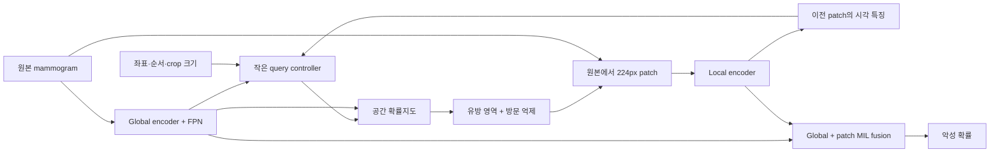

# 시선 경로 예측 및 시선 기반 유방촬영 분석: 문헌 조사와 개선안

조사일: 2026-10-10. 논문 원문·저자 코드·학회 페이지를 근거로 정리했다. 아래 모델은 일반 영상의 scanpath, 의료영상 검출, 유방촬영 분류 등 서로 다른 문제를 다룬다. 논문의 성능 수치를 우리 AUROC와 직접 비교하지 않는다. 이번 작업은 조사와 설계이며 새 모델 학습을 수행하지 않았다.

## 1. 현재 결과가 말해주는 것

로컬 근거: `runs/trajectory_constraints_seed42/report.md`, `runs/finetuning_report_seed42/report.md`, `runs/baseline_seed42/comparison.csv`, `literature/local_diagnostics.json`.

- 큰 Swin-B와 decoder에서도 argmax 경로가 대부분 한 위치를 반복했다. hard 방문 억제는 이를 16개 위치로 바꾸지만 이는 생성 정책의 효과다.
- full Swin-B 파인튜닝은 학습 loss를 낮췄지만 validation 선택은 초기 상태(epoch0)였다. CF 3개 중 2개도 초기 상태를 유지했다.
- 유방 mask + hard112 + sample 조건에서 patch ResNet50 파인튜닝 AUROC는 0.693이었다. baseline 0.666 대비 paired CI가 0을 포함한다.
- 전체 영상 baseline AUROC는 0.742였다. global-only와 patch-only의 학습 설정 및 CI가 달라 원인을 확정할 수는 없지만, global context를 분류에서 제외하는 설계는 점검할 가치가 있다.

### 코드와 학습 타깃 진단

| 항목 | 현재 상태 | 확인할 가설 |
|---|---|---|
| 다음 위치 head | decoder 벡터 → 독립적인 1,152개 cell logits | 이미지의 국소 특징과 위치 점수가 충분히 연결되지 않는가 |
| 과거 방문 정보 | cell ID embedding + 순서 embedding | 방문한 곳의 실제 시각 내용이 부족한가 |
| 영상 해상도 | 원본 PNG 1500×3000 → 256×512 | 작은 소견을 global encoder가 놓치는가 |
| backbone 마지막 feature map | 8×16, 원본 기준 stride 187.5px | 조밀한 위치 예측에 필요한 상세 특징이 부족한가 |
| 224px 영역 | trajectory 입력에서는 약38.2px 폭 | 원본 crop을 사용하는 foveal branch가 도움이 되는가 |
| 학습 경로 | 376장 × 16 = 6,016개 축약 지점 | 많은 출력 cell에 학습 근거가 적은가 |
| cell 지원 | 907개 cell 관측, 245개 미관측; 관측 cell당 target 중앙값5 | 공간적으로 공유하는 head와 부드러운 감독이 더 효율적인가 |
| 타깃 중복 | grid 기준 평균3.49% | 실제 타깃 반복은 argmax의 거의 완전한 반복 수렴을 설명하지 못함 |

시선 지점은 같은 영상 안에서 상관되어 있으므로 6,016개의 독립 표본으로 해석하지 않는다. 위 원인은 **코드와 결과에 따른 가설**이며 ablation으로 확인해야 한다.

## 2. 관련 연구에서 가져올 방법

### Gazeformer — CVPR 2023

연속 좌표의 Gaussian 평균·log-variance와 유효 여부를 예측하며, 순서별 query를 병렬 decoding한다. 재매개화한 좌표에는 L1, 유효 여부에는 BCE를 사용한다. 따라서 원 논문을 Gaussian NLL 모델이라고 설명하면 부정확하다. 우리에게는 거리 정보를 반영하는 좌표 head와 병렬 baseline이 참고가 된다. 시간 정보가 없어 no-duration 구성으로 비교해야 한다. [원문 §3](https://arxiv.org/html/2303.15274v3), [학회 페이지](https://openaccess.thecvf.com/content/CVPR2023/html/Mondal_Gazeformer_Scalable_Effective_and_Fast_Prediction_of_Goal-Directed_Human_Attention_CVPR_2023_paper.html)

### Human Attention Transformer (HAT) — CVPR 2024

낮은 해상도의 주변 특징과 이전 fixation에서 얻은 높은 해상도 특징을 working memory로 결합한다. task query와 높은 해상도 feature map의 내적으로 다음 위치 지도를 만들고, Gaussian으로 부드럽게 만든 타깃에 focal loss를 적용한다. 종료도 예측한다. **방문 위치의 내용**을 feedback하는 설계가 핵심 참고점이다. [원문 §3](https://arxiv.org/html/2303.09383v3)

### DeepGaze III — Journal of Vision 2022

영상과 최근 fixation history에서 다음 위치의 조건부 분포를 학습하고, 확률적으로 경로를 생성한다. 공간적 주목도 학습 후 경로 모델을 학습하는 단계적 접근과 likelihood 평가가 참고된다. 자연영상 free-viewing 결과를 의료영상에 그대로 적용할 수는 없다. [원 논문](https://pmc.ncbi.nlm.nih.gov/articles/PMC9055565/), [저자 페이지](https://bethgelab.org/publication/2022_04_kummerer/)

### GAA-DETR — MICCAI 2025, 현재 데이터의 원 연구

확대 정보에 따라 gaze kernel을 조정하고 시선 주목도를 detection query의 감독으로 사용한다. 순서 있는 경로 생성 모델은 아니다. 우리에게는 원시 배율을 좌표 복원에만 쓰는 대신 **attention 감독의 강도·공간 범위**에도 활용하는 ablation이 참고된다. 원시 CSV scale과 논문 magnification의 정의를 먼저 대조하고 제공 demo를 확인한다. [원문](https://papers.miccai.org/miccai-2025/paper/1266_paper.pdf), [학회 페이지](https://papers.miccai.org/miccai-2025/0738-Paper1266.html)

### GMIC — Medical Image Analysis 2021

전체 영상의 saliency에서 겹침을 억제하며 ROI 패치를 고르고, patch attention 표현과 global 표현을 결합해 분류한다. global/local/fusion 예측에 감독을 제공한다. 우리 실험에서는 **global context를 분류에 다시 넣는 것**과 동일 K의 class-saliency selector가 중요한 비교 대상이다. 원 연구는 screening의 benign/malignant 존재 예측이며 우리 benign-vs-malignant 주석 영상 분류와 다르다. [원문](https://arxiv.org/abs/2002.07613), [저자 코드](https://github.com/nyukat/GMIC)

### GLAM — MIDL 2021

전체 영상에서 ROI를 찾고 선택한 영역을 높은 해상도로 처리해 세밀한 localization을 학습한다. 단순히 이미지 backbone만 확대하기보다 global/local 경로의 해상도 역할을 분리할 근거다. 여기서 GLAM은 Global-Local Activation Maps이며 2025년 동명 multi-view alignment 연구와 구분한다. [학회 원문](https://proceedings.mlr.press/v143/liu21b.html)

### SalTR — WACV 2024

시선 위치를 집합으로 예측하고 bipartite matching으로 중복 없는 fixation 선택을 학습한다. K개 patch selector의 대조군으로 참고할 수 있지만, 집합 loss는 시간 순서를 보존하지 않는다. 우리 순차 모델의 손실로 그대로 대체하면 순서의 기여를 검증할 수 없다. [학회 원문](https://openaccess.thecvf.com/content/WACV2024/html/Djilali_Learning_Saliency_From_Fixations_WACV_2024_paper.html)

### McGIP — 2023 arXiv 공개 원고

시선 유사성을 이용해 의료영상 contrastive pretraining의 positive pair를 구성한다. 의료영상 표현 학습에 gaze를 사용하는 참고점이다. 우리에게는 같은 이미지의 gaze ROI를 활용한 사전학습부터 검토하는 것이 안전하다. 다른 이미지가 비슷한 위치를 본다는 이유만으로 병리 의미가 같다고 가정하지 않는다. [원문](https://arxiv.org/html/2312.06069v2)

### DeepGaze3.5-VL — 2026년7월 arXiv 프리프린트

사전학습 VLM을 LoRA로 조정해 좌표 token을 autoregressive하게 예측하고 information gain으로 평가한다. **token CE 자체가 원천적으로 부적절한 것은 아니다.** 현재의 작은 gaze 데이터로 scratch decoder를 학습하는 경우와, 대규모 사전학습된 시각·순차 priors를 사용하는 경우를 구분해야 한다. 자연영상 결과이며, 의료영상 성능을 검증한 근거로 사용하지 않는다. [원문](https://arxiv.org/html/2607.02083v1)

## 3. 데이터 해석에서 새로 확인한 점

GAA-DETR 원문 §3은 **Tobii 4C·100Hz** 수집과 annotation workflow를 명시한다. breast subset도 857장·malignant 367/benign389개로 로컬 데이터와 일치한다. MicEye 공개 도구는 zoom/drag와 eye-gaze 기록을 지원한다. [GAA-DETR 원문](https://papers.miccai.org/miccai-2025/paper/1266_paper.pdf), [MicEye 저자 코드](https://github.com/YanKong0408/MicEye-v2.0)

다만 공개 CSV에는 타임스탬프·판독자/세션 ID·병합 규칙이 없다. 하드웨어 nominal100Hz를 근거로 export된 모든 인접 행에 정확한10ms 간격을 부여할 수는 없다. 인덱스와 실제 fixation, 체류 시간, 영상 판독 종료를 구분해야 한다.

현재 모든 training target이 정확히16개다. 이는 K까지 축약한 타깃이지 임상적으로 확인한 종료 시점이 아니다. 먼저 fixed K 실험을 유지하고, 종료 head나 체류 시간 학습은 metadata 확보 뒤 검토한다.

CBIS의 **학습 환자에 속한 미주석36장**은 gaze map 사전학습에 추가할 수 있다. 이 영상에 benign 라벨을 부여하지 않는다. validation/test gaze와 INbreast quarantine을 사전학습에 포함하지 않는다.

## 4. 추천하는 다음 구조

주요 변경은 공간적으로 공유하는 위치 head, 이전 patch의 시각 feedback, 분류의 global/local 결합이다. 이는 문헌의 설계에서 도출한 **우리 데이터용 제안**이며 성능은 아직 측정하지 않았다.

### A. 가장 먼저: 위치 head와 공간 감독

현재 `Linear(query, 1152)`를 query와 위치별 feature의 내적 형태로 바꾼다. 모든 위치에서 공유하는 score head가 image-conditioned 위치 지도를 만들도록 한다. 좌표 ID 대신 정규화 `(x,y)`의 Fourier/RBF embedding도 비교한다.

타깃은 한 cell만1인 벡터와 Gaussian soft target을 비교한다. 후자는 다음 위치의 근처에도 학습 신호를 제공한다. 제안 loss는 정규화 확률지도에 대한 soft CE/KL이다. **HAT의 focal loss와 동일 구현이라고 부르지 않는다.** focal loss 및 Gazeformer-inspired 연속 좌표 head는 별도 대조군이다.

Gaussian bandwidth는 원본 PNG 픽셀 단위로 정의하고 출력 해상도에 맞춰 변환한다. 예비 후보는48/96/192px이며 train 내부에서 범위를 점검하고 validation 설정을 고정한다. scale-aware target은 별도 ablation으로 분리한다. viewer의 실제 확대 배율은 inference 입력으로 제공하지 않는다.

### B. 그다음: 실제로 본 patch를 다음 위치 예측에 넣기

이전 위치의 원본224×224 patch embedding을 좌표·순서·crop 크기 정보와 함께 memory에 추가한다. 현재 가장 유망했던 ResNet50 local encoder를 출발점으로 삼는다. HAT는 높은 해상도 feature map에서 foveal token을 뽑지만, 여기서는 원본 crop을 사용하는 변형을 제안한다.

첫 실험은256차원·2층 controller로 진행한다. 전체 영상 입력512×1024와 현재256×512를 비교한다. 고해상도 입력·FPN·patch feedback을 한 번에 켜서 효과를 섞지 않는다. first position은 영상만으로 예측하며 실제 첫 gaze를 inference에 제공하지 않는다.

### C. 분류에는 전체 영상 문맥 추가

global vector와 K개 patch의 MIL vector를 concatenate하여 fusion head를 학습한다. global-only, local-only, fusion 결과를 함께 기록한다. 224 crop과448 crop→224 resize를 비교해 문맥 부족을 점검한다.

시선의 재방문을 재현하는 분포와 분류를 위한 비중복 patch policy를 구분한다. 원본 gaze imitation loss에 모든 재방문을 금지하는 penalty를 붙이지 않는다. 사용자 목표의 비중복 제약은 inference patch selector에 유지한다.

### D. 학습 순서

1. train412장(주석376+미주석36)의 gaze map으로 공간 attention 학습. 주석 없는 영상은 classification loss에서 제외.
2. 같은 spatial head에서 순차 controller와 foveal memory 학습.
3. 주석 train376장으로 global/local classifier 학습 및 fine-tuning. 필요하면 마지막 backbone stage 또는 adapter부터 조정.
4. classification용 training 경로는 환자 단위 cross-fitting으로 생성. 공간 사전학습도 각 CF fold의 held-out 환자를 제외해 수행한다.
5. 실제 gaze와 classifier 목표가 충돌하는지 loss weight ablation으로 확인. 진단 라벨을 task prompt나 다음 위치 predictor의 정답 입력으로 사용하지 않는다.

연속 좌표 regression을 사용한다면 단일 평균 좌표만으로 여러 후보를 표현하지 못할 수 있다. Gaussian/mixture head는 대안이지만, 이번 우선 구현은 mask·visit 제약과 연결하기 쉬운 공간 지도다.

## 5. 단계별 비교 실험

| 단계 | 비교 | 주 질문 |
|---|---|---|
| E0 | train-only spatial prior + IOR / gaze heatmap + IOR / class saliency + IOR | 학습한 영상 정보가 일반적인 위치 prior보다 유용한가 |
| E1 | 기존 CE head / 공유 spatial head / 공유 head + Gaussian target | 표현과 loss 중 무엇이 반복 수렴을 줄이는가 |
| E2 | E1 + FPN, 입력 해상도 하나씩 변경 | 세밀한 공간 정보의 효과인가 |
| E3 | E2 + 이전 high-resolution patch feedback | 방문한 내용이 다음 위치 선택에 기여하는가 |
| E4 | 실제 순서 / 순서 섞기 / 순서 없는 heatmap+IOR 또는 set selector | 순서의 추가 가치가 있는가 |
| E5 | global-only / patch-only / global+patch fusion | gaze patch가 global 분류에 추가 정보를 주는가 |
| E6 | 224 / 448→224, K8/16/32 | 같은 budget에서 필요한 문맥과 탐색 지점 수는 무엇인가 |

모든 selector는 같은 mask·patch encoder·K·crop 크기를 사용한다. 모델 개수 증가가 아니라 위 가설 순서로 비교한다. 주요 결과를3 seeds로 반복하고 설정이 고정되면 원본 Test131장을 평가한다. 이미 반복 사용한 val93장은 개발 결과로 보고한다.

## 6. 평가를 보강할 부분

- **다음 위치 분포:** held-out NLL과 train-only spatial prior 대비 conditional information gain. 같은 좌표 체계와 likelihood 지지 영역을 사용한다. prior는 train에서만 bandwidth와 smoothing을 결정한다.
- **영상을 쓰는지:** view/좌우/출처를 고려한 image-shuffling 대조군과 history-only 대조군. learned prior가 이미지 내용에 실제로 반응하는지 확인한다.
- **전체 경로:** DTW에 더해 위치별 ADE/FDE, 이동 거리 분포 및 방문 다양성. 현재 DTW의 길이 합 normalization은 정렬 거리 평균과 다르므로 작은 수치만으로 품질을 판단하지 않는다.
- **Hard policy:** 실제 GT가 돌아간 셀이나 추정 마스크 밖 위치를 금지하면 likelihood가0이 될 수 있다. raw probabilistic model의 gaze 평가와 constrained patch policy의 평가를 분리한다.
- **분류:** AUROC/AUPRC, validation에서 고정한 threshold의 sensitivity/specificity, calibration, K와 실제 실행 비용에 따른 성능. gaze의 conditional AUC와 악성 분류 AUROC를 혼동하지 않는다.
- **커버리지:** 영상 단위 any-hit뿐 아니라 병변별 hit, 병변 크기별 분석, patch 유방 포함률 및 overlap. large lesion과 small lesion을 구분한다.

## 7. 연구 주장과 우선순위

현재 가장 타당한 우선순위는 **공유 spatial head + 부드러운 gaze 감독 → high-resolution patch feedback → global/local fusion**이다. 큰 backbone 추가 비교는 이 가설을 먼저 확인한 후 수행한다.

HAT와 GMIC의 구성 요소를 결합했다는 사실만으로 novelty가 입증되지는 않는다. 논문 기여는 다음을 실험으로 보여주는 데서 나온다: 동일한 patch/compute budget에서 gaze-supervised 순차 탐색이 정적 attention이나 class saliency보다 유용한지, 방문 내용이 다음 위치를 개선하는지, 순서가 실제 분류 이득을 주는지.

만약 heatmap+IOR가 sequence 모델과 비슷하면 결과를 공간적 gaze supervision의 효과로 설명한다. 순서 이점이 검증되지 않은 상태에서 임상적 판독 과정을 재현했다고 주장하지 않는다. 자연영상 gaze 사전학습 모델이나 VLM+LoRA는 후속 후보이며 먼저 의료영상 전이와 누수 없는 적응을 확인한다.

## 8. 조사 파일

- `literature/source_manifest.json`: 다운로드한 원문6종의 URL, PDF hash, page count.
- `literature/sources/`: 원문 PDF와 추출 text (일부 PDF의 수학 기호는 대체 문자로 추출되어 식 해석은 원문 HTML/코드도 대조).
- `literature/local_diagnostics.json`: 이번 train-only 타깃·해상도 진단.
- DeepGaze III, SalTR, McGIP는 위 저자/학회/원고 페이지에서 확인했다.

최신 검색에서 2차 리뷰만 확인한 방법은 구체적 설계 근거에서 제외했다. 이 문서의 제안은 아직 검증된 성능 개선이 아니며 기존 checkpoint나 학습 결과를 변경하지 않았다.
