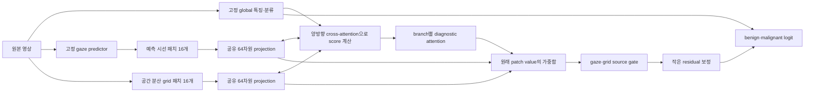

# CXR 시선 기반 분류 연구의 적용: 2026-10-11

## 질문과 결정

시선이 모인 부분은 병변, 치밀한 정상 조직, 비교를 위한 배경, 인공물 중 어느 것일 수도 있다. 현재 입력은 실제 판독자의 gaze가 아니라 image-only 모델이 생성한 16개 위치다. 따라서 gaze 재현 정확도, attention 집중도, benign/malignant 분류 성능을 서로 다른 목표로 평가한다.

이번에는 **예측 gaze 16개 + 영상 기반 공간 분산 grid 16개 + 기존 global 분류**를 결합한다. 시선과 별개로 선택한 비교 패치가 있어야 특정 시선 패치의 의미를 주변 영상 정보와 함께 평가할 수 있다. gaze 입력을 학습 중 일부 생략해 gaze에 대한 과도한 의존을 줄이는 가설을 검증한다. 이것은 아래 CXR 연구의 원리를 현재 frozen-feature 환경에 옮긴 실험이며, 원 논문의 재현 또는 CXR에서의 성능 검증이 아니다.

설계·문헌 검토·최종 실험 판단은 부모 에이전트가 수행하고, 구현은 기존 sol-low 서브에이전트에 맡긴다.

## 조사한 일차 문헌

| 연구 | 시선 활용과 추론 조건 | 이번 작업에 주는 의미 |
|---|---|---|
| [GG-CAM, Zhu et al., 2022 preprint](https://arxiv.org/abs/2202.07107) | CXR 분류기의 CAM을 expert gaze로 지도. 학습 후 gaze 없이 추론 | attention supervision의 비교 대상. 예측 gaze를 병변 정답으로 삼는 근거는 아님 |
| [RadioTransformer, ECCV 2022](https://www.ecva.net/papers/eccv_2022/papers_ECCV/papers/136810669.pdf) | global/focal transformer와 gaze를 이용한 teacher–student 학습. gaze 없는 추론, 여러 CXR 데이터셋 평가 | 국소 시선과 전체 영상 맥락을 함께 다루는 근거. 이번에는 teacher–student 전체 재학습을 수행하지 않음 |
| [GazeGNN, WACV 2024; arXiv v3 2023](https://arxiv.org/html/2305.18221v3) | 영상 패치, 위치, 실제 fixation duration embedding을 결합한 kNN graph. gaze를 모델 입력으로 사용 | gaze를 입력 정보로 취급하고 패치 관계를 학습. 이번에는 predicted coordinates와 cross-attention으로 적용하며, GNN·실제 duration은 재현하지 않음 |
| [Localization supervision using label-specific eye-tracking, Frontiers 2023](https://www.frontiersin.org/journals/radiology/articles/10.3389/fradi.2023.1088068/full) | 발화와 gaze의 시간차를 고려해 질환별 localization supervision 구성 | 시선 전체가 한 질환의 근거는 아님. Table 5의 평균 AUC는 unannotated 0.767, ET 0.765; IoU는 0.201→0.256. localization 개선과 분류 개선은 구분해야 함 |
| [Seeing Through Expert's Eyes, ACCV 2024](https://openaccess.thecvf.com/content/ACCV2024/html/Sultana_Seeing_Through_Experts_Eyes_Leveraging_Radiologist_Eye_Gaze_and_Speech_ACCV_2024_paper.html) | gaze·speech report·영상을 GNN/지식 전달로 학습, 추론은 영상만 사용 | 학습 때만 있는 전문가 정보를 전이하는 대안. 현재 보고서 정렬 정보가 없으므로 그대로 적용 불가 |
| [GazeLT, 2025 preprint](https://arxiv.org/html/2508.09478v1) | 시간 구간별 gaze integration/disintegration으로 teacher를 학습하고 long-tailed CXR 분류 student로 전달 | 실제 시간 정보와 불균형 질환 분류에 초점. 현재의 16개 생성 step을 실제 fixation duration으로 해석하지 않음 |
| [Gaze-guided vision transformer for chest X-ray image classification, Chen et al., BSPC 111, 2026](https://doi.org/10.1016/j.bspc.2025.108298) | GII의 bottleneck/spatial fusion과 학습 중 gaze 입력 생략. gaze 없이도 추론 | 비질환 대상에 대한 gaze와 supervision 불확실성을 직접 논의. 이번의 작은 projection 및 gaze modality dropout의 주 근거 |

검토 범위: GazeGNN·GazeLT·Frontiers는 본문, 나머지는 제공된 공식 초록/출판사 공개 본문 또는 논문 PDF에서 확인한 내용에 한정한다. GII-ViT의 비공개 세부 hyperparameter/정량 성능을 추측해 재현했다고 주장하지 않는다. 문헌 간 AUROC는 데이터와 label 정의가 달라 순위 비교하지 않는다. Follow My Eye (TMI 2022)는 관련 방법이지만 무릎 X-ray 연구이므로 CXR 연구로 분류하지 않았다.

## 구체적인 모델



1. 고정 ConvNeXt/gaze feature cache를 재사용한다. Gaze16은 seed42 image-only rollout, grid16은 밝기>10 후보들의 공간 분산 선택이다. grid도 임상 segmentation이나 병변 정답이 아니며 영상 전체를 빠짐없이 덮지 않는다.
2. 1024차원 patch feature를 공유 projection으로 64차원 `z_i`로 압축한다. 패치 원래 value는 pooling까지 보존한다.
3. 두 branch 사이 cross-attention으로 상대 패치 정보를 참조한다. 좌표 embedding은 Q/K 및 score 계산에만 사용한다. 각 패치의 gated MIL score는 자체 feature, 상대 branch context, global context로 계산한다. 예측 순서가 실제 관찰 시간을 뜻하지 않으므로 시간 embedding은 넣지 않는다.
4. 각 branch 내부 attention은 동일 좌표 중복 개수의 역수로 보정한다. cross-attention의 key softmax에도 같은 보정을 적용한다. 중복 패치 추가가 예측을 바꾸지 않아야 한다.
5. gaze/grid pooling 결과를 학습 가능한 source gate `beta`로 결합한다. 한 branch가 없으면 다른 branch를 사용한다. 두 branch가 없으면 기존 global logit을 그대로 반환한다.
6. `logit = frozen_global_logit + alpha * delta(z)`를 사용한다. alpha 초기값 0.1, delta 초기값 0. global dropout도 eval로 고정한다. loss는 이전 실험과 같은 BCE + 0.25 local BCE + 0.01 residual²이다.
7. dropout 조건에서는 학습 bag마다 확률 0.3으로 gaze branch를 생략한다. 평가 때는 dropout 없이 두 branch를 사용하고 별도로 gaze 부재 실험을 보고한다.
8. padding 조건에서는 224×224 crop 중 원본 영상 안쪽 비율 `q`를 정확히 계산해 attention score에 `log(q)`를 더한다. q=0은 제외한다. 이 prior는 추가 가설이며 CXR 논문의 직접 재현 항목이 아니다. 밝기·치밀도·조직 추정 마스크로 패치를 제거하지 않는다. 실제 촬영 artifact나 marker를 식별하는 모듈은 이번에 구현하지 않는다.

관측된 case64의 오른쪽 검은 부분은 crop이 영상 밖으로 나가 생긴 padding이다. 이를 획득 영상 artifact나 조직 치밀도로 해석하지 않는다. 밝은 crop이라는 이유만으로 BI-RADS density나 병변을 판정하지 않는다.

패치별 `alpha * beta_source * attention_i * (delta_weight dot z_i)`와 별도 bias를 기록한다. 합은 residual logit과 일치해야 한다. 양의 attention은 선택 비중이고, signed contribution은 악성 logit 방향이다. gate를 고정한 대수적 분해이므로 인과 설명은 아니다.

## 실행 전에 고정한 비교

| 조건 | 두 branch 내 pooling | Gaze bag dropout | Padding prior |
|---|---|---:|---:|
| dual_mean | 중복 보정 평균 | 0 | 없음 |
| dual_cross | 상대 branch/global 조건부 attention | 0 | 없음 |
| dual_cross_drop | 동일 | 0.3 | 없음 |
| dual_cross_drop_quality | 동일 | 0.3 | log(inbounds fraction) |

주 후보는 `dual_cross_drop_quality`, 주 비교는 같은 32개 패치를 쓰는 `dual_mean`이다. 순차 ablation으로 attention/dropout/padding prior의 영향을 살핀다. 이전 gaze16 평균 residual 및 global도 참조하되, 16→32 패치 증가는 추가 영상 정보/연산을 동반하므로 이 차이를 attention 하나의 효과로 해석하지 않는다.

- 동일 train376장/306환자, validation93장/77환자. Head seed42/43/44. Frozen gaze/global와 생성 seed42를 공유하므로 전체 pipeline 3seed가 아니다.
- AdamW lr3e-4, weight decay0.01, batch32, 최대60epoch, patience12. epoch0의 global 기준점도 선택 가능. 기존 모델과 같은 선택 규칙.
- AUROC/AUPRC/Brier 및 sensitivity/specificity@0.5. 환자 단위 paired bootstrap1000. 단일 head 평균과 3head ensemble은 별도로 표시.
- 같은 validation이 기존 gaze/global 선택에도 쓰였으므로 개발 실험이다. bootstrap이 선택 편향을 제거하지 않는다. 최종 test/INbreast quarantine은 사용하지 않는다.
- Gaze/grid branch 제거, 상위4개/고정 random4 제거, uniform attention, 다른 validation 영상의 gaze feature+좌표를 함께 교환하는 진단을 수행한다. 교환은 합성 입력 민감도 분석이며 환자의 실제 반사실이나 gaze의 인과 효과가 아니다. 모델 선택에는 쓰지 않는다.
- validation case64를 고정해 중간/최종 patch attention과 GT benign을 표시한다. 최종 비교에는 validation에서 ID가 가장 작은 malignant case73도 고정한다. GT gaze/병변 박스는 모델 입력에 넣지 않는다.
- 체크포인트는 작은 head best만 저장하고 기존 cache/encoder/global를 hash 검증 후 참조한다.

## 성공 판정과 범위

AUROC가 개선되고 불확실성이 뒷받침되어야 성능 향상으로 해석한다. attention이 뾰족해지거나 padding weight가 작아지는 것만으로 성공 판정하지 않는다. dropout이 gaze 부재에 견디는지와 정상 입력의 분류 성능을 함께 확인한다. 새 모델이 평균 pooling보다 못하면 기존 기준 모델을 유지하고 실패 결과를 그대로 기록한다.

이 실험은 인간 시선이 실제 병변을 더 잘 찾는다는 증명, artifact 제거 성능 검증, 독립 CXR 외부 평가, encoder end-to-end 재학습을 포함하지 않는다. 새로운 CXR 데이터를 내려받지 않고 기존 mammography 모델에 연구 원리를 적용한다.

## 구현과 실행

- 모델: [src/gaze_cxr_1011.py](src/gaze_cxr_1011.py)
- 학습/비교: [scripts/train_cxr_attention_1011.py](scripts/train_cxr_attention_1011.py)
- 영상 단독 추론: [scripts/predict_cxr_attention_1011.py](scripts/predict_cxr_attention_1011.py)
- 3-head 확률 ensemble 추론: [scripts/predict_cxr_ensemble_1011.py](scripts/predict_cxr_ensemble_1011.py)
- 부모의 사후 검증: [scripts/audit_cxr_attention_1011.py](scripts/audit_cxr_attention_1011.py)
- 회귀 테스트: 기존58개 + 모델9개 + ensemble3개, 총70개 통과. 실제 cache의 4조건 smoke도 완료.

```bash
python gaze_mammo/scripts/train_cxr_attention_1011.py --output gaze_mammo/runs/cxr_attention_1011_new --threads 4
python gaze_mammo/scripts/predict_cxr_attention_1011.py --head gaze_mammo/runs/cxr_attention_1011_new/dual_cross_drop_quality_seed42/best.pt --image gaze_mammo/data/image/Mass-Training_P_00026_LEFT_CC_BENIGN.png --image-id 64 --compare-cache --output gaze_mammo/runs/cxr_attention_1011_new_case64
python gaze_mammo/scripts/audit_cxr_attention_1011.py --run gaze_mammo/runs/cxr_attention_1011_new
```

실행할 때 기존 결과를 덮어쓰지 않도록 새 output 경로를 사용한다. source cache와 global/gaze checkpoint가 필요하며 SHA256으로 정합성을 확인한다.

실험에서 ensemble AUROC가 가장 높았던 dropout 모델의 영상 단독 추론은 다음과 같다. 이미지 특징을 한 번 추출해 세 head가 공유하며, 악성 확률을 산술평균한다. Ensemble의 단일 attention/logit 기여도로 오해하지 않도록 개별 head 진단을 따로 저장한다.

```bash
python gaze_mammo/scripts/predict_cxr_ensemble_1011.py \
  --heads gaze_mammo/runs/cxr_attention_1011_full/dual_cross_drop_seed42/best.pt \
          gaze_mammo/runs/cxr_attention_1011_full/dual_cross_drop_seed43/best.pt \
          gaze_mammo/runs/cxr_attention_1011_full/dual_cross_drop_seed44/best.pt \
  --image gaze_mammo/data/image/Mass-Training_P_00026_LEFT_CC_BENIGN.png \
  --image-id 64 --compare-cache --output gaze_mammo/runs/cxr_ensemble_new_case64
```

## 완료 결과

4조건×3head-seed 전체 학습과 진단을 완료했다(667.4초). 단일 head AUROC 평균±SD는 dual_mean0.7663±0.0023, dual_cross0.7801±0.0039, dual_cross_drop0.7755±0.0038, dual_cross_drop_quality0.7690±0.0018이다. 이전 gaze16 평균 residual은0.7727±0.0047이었다.

별도의3-head ensemble AUROC는 각각0.7683/0.7794/0.7914/0.7710이었다. 최고 ensemble(dropout)의 이전 gaze16 평균 ensemble 대비 차이는+0.0222, 환자95%CI[−0.0605,+0.1100]이다. 사전 주후보 padding 모델의 dual_mean 대비 차이도+0.0028, CI[−0.0254,+0.0332]로 우월성을 확인하지 못했다. 따라서 cross 단일 head와 dropout ensemble을 후속 검증 후보로 남기고, padding prior를 성능 향상 기법으로 채택하지 않는다. 이는 결과를 본 후의 후보 선택이며 독립 test 결과가 아니다.

GT 박스와 한 번이라도 겹치는 영상은 gaze16이76/93, grid 추가 후82/93이었다. 고정 malignant73은 두 source 모두 박스를 놓쳤다. Padding 가중치를 줄이는 것만으로 영상 내부의 배경/경계와 병변을 구분하지 못한다는 한계도 확인했다. 모든 병변·실제 시선 정보는 사후 평가/표시에만 사용했다.

상세 해석·paired CI·GT 시각화·검증은 [부모 검토 보고서](runs/cxr_attention_1011_full/parent_review.md), 전체 수치는 [학습 보고서](runs/cxr_attention_1011_full/report.md)에 있다. 본학습 head12개는 총4.47MiB이며 기존 encoder/cache를 복제하지 않았다.
